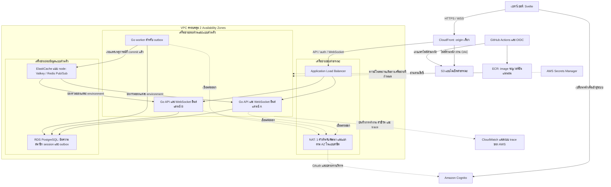

# สถาปัตยกรรมระบบและการไหลของข้อมูล

> ฉบับละเอียดก่อนย่อ Notion เก็บเมื่อ 2026-10-28
> เอกสารแผนและข้อสรุป ไม่ใช่หลักฐานว่าพัฒนา ทดสอบ หรือ deploy สำเร็จ
> ที่มา: [หน้า Notion](https://www.notion.so/403766880300819cb50bc46ac6cbf130) — ปัจจุบันเป็นฉบับย่อ

อ้างอิงข้อสรุป: [ข้อสรุปการออกแบบและงานที่เลื่อนไประยะถัดไป](03-decisions-and-deferred-work.md) และ [แผนพัฒนาและเกณฑ์ตรวจรับ](02-implementation-and-acceptance.md)

**สถานะ: ยืนยันแบบสถาปัตยกรรมแล้ว แต่ยังไม่ได้พัฒนา ทดสอบ หรือขึ้นระบบ AWS**
ปรับปรุงเมื่อ 2026-10-25 โดยใช้ขอบเขตสาธิตโครงสร้างพื้นฐานเป็นหลัก การสมัคร AWS จะทำภายหลัง

## เป้าหมายและขอบเขต

สร้างระบบแชทขนาดเล็กเพื่อแสดงการใช้คลาวด์อย่างมีเหตุผล ทำซ้ำได้ ปลอดภัย และตรวจสอบการทำงานได้ ปัญหาหลักคือการส่งข้อความข้ามโปรแกรมหลายอินสแตนซ์ โดยข้อความที่ยืนยันรับแล้วต้องยังเรียกคืนได้เมื่อโปรแกรมล่มหรือการแจ้งเตือนสูญหาย ผู้ใช้คือเพื่อนร่วมชั้นและผู้ทดสอบที่ได้รับเชิญ

ขอบเขตสาธิตประกอบด้วยการเข้าสู่ระบบ บัญชีและห้องสนทนาที่เตรียมไว้ การส่งข้อความ การดูประวัติ การเชื่อมต่อใหม่ การส่งข้ามอินสแตนซ์ การกู้คืนงานของ worker การปล่อยเวอร์ชันแบบ rolling และแดชบอร์ด ส่วนหน้าจัดการกลุ่มและฟีเจอร์แชทเพิ่มเติมอยู่ในระยะถัดไป ระบบเป็นแอปเดียวที่มีแชทส่วนตัวและกลุ่มปิด ไม่มีหลาย workspace

## โครงสร้างระบบบน AWS

ส่วนหน้าใช้ Svelte + TypeScript + Vite สร้างไฟล์สำหรับเก็บใน S3 แบบไม่เปิดสาธารณะ และให้ CloudFront อ่านผ่าน Origin Access Control เส้นทาง API การยืนยันตัวตน และ WebSocket ส่งต่อไป ALB ภายใต้ origin เดียวกัน เส้นทางที่มีข้อมูลผู้ใช้ต้องไม่ถูกแคช และต้องส่งต่อ cookie, query string, Origin และ header ของ WebSocket ตามที่กำหนด

Go API และ WebSocket ทำงานใน ECS/Fargate บน private subnet ส่วน Go worker เป็นอีก ECS service ใช้ repository และ image เดียวกันแต่เรียกคำสั่ง worker แยกกัน ทั้งคู่ใช้แบบจำลองข้อมูลเดียวกัน จึงยังเป็น modular monolith ที่แยกบทบาทการรัน ไม่ใช่ microservices ที่แยกเจ้าของข้อมูล

แผนภาพนี้เป็นแบบออกแบบเชิงตรรกะ ไม่ใช่หลักฐานว่ามีทรัพยากรจริงแล้ว แผนภาพนำเสนอต้องปรับให้ตรงกับ Terraform และตำแหน่งทรัพยากรในแต่ละ AZ หลังตรวจสอบระบบจริง รุ่น engine ขนาดเครื่อง region และใบรับรองยังต้องยืนยัน

## หน้าที่ของโมดูล

- **ตัวตนและ session:** ตรวจตัวตน Cognito เชื่อมกับผู้ใช้ภายใน รับ OAuth callback และจัดการ session ใน PostgreSQL เบราว์เซอร์ถือเพียง cookie ที่เป็นรหัส session แบบ Secure และ HttpOnly
- **ห้องสนทนา:** ข้อมูลห้อง สมาชิก บทบาทเจ้าของและผู้ดูแล และการตรวจสิทธิ์จากฐานข้อมูล
- **ข้อความ:** ตรวจเนื้อหา ป้องกันข้อความซ้ำ จัดลำดับต่อห้อง บันทึกข้อความพร้อม outbox และเรียกประวัติ
- **การกู้คืน:** แบ่งหน้าข้อมูล อ่านตำแหน่งล่าสุด เชื่อมต่อใหม่ และตรวจหาข้อมูลตกหล่น
- **การสื่อสารสด:** ตรวจสิทธิ์การเชื่อมต่อและติดตามห้อง จัดทะเบียน socket ในอินสแตนซ์ จำกัดคิว ตรวจ heartbeat และระบายการเชื่อมต่อก่อนหยุด
- **Outbox:** จองงานแบบกู้คืนได้ กำหนดเวลาลองใหม่ เผยแพร่เหตุการณ์ และวัดงานค้าง
- **สถานะอ่านและการออนไลน์:** พัฒนาในระยะถัดไป ไม่ใช่เงื่อนไขก่อนสาธิตโครงสร้างพื้นฐาน

HTTP และ WebSocket เป็นตัวแปลงคำขอไปยังงานของแอป กฎธุรกิจไม่ผูกกับ AWS, Redis หรือ WebSocket โดยตรง สร้าง interface เฉพาะขอบเขตที่ใช้งานจริง ไม่สร้างชั้นว่างไว้ล่วงหน้า

## เจ้าของข้อมูลและสถานะชั่วคราว

PostgreSQL เป็นแหล่งอ้างอิงสำหรับผู้ใช้ ห้อง สมาชิก ข้อความ ลำดับ session และงานรอเผยแพร่ ส่วนตำแหน่งอ่านระดับผู้ใช้จะเพิ่มภายหลัง การจองงาน outbox ต้องคงอยู่หลัง transaction จองงานจบ และเรียกคืนได้เมื่อผู้ทำงานตาย

Pub/Sub เป็นการแจ้งเตือนรวดเร็วที่อาจสูญหาย แต่ละ environment ใช้ช่องร่วมแยกกัน ทุกอินสแตนซ์รับเหตุการณ์แล้วเลือกผู้รับที่เชื่อมกับตนเอง พร้อมตรวจสิทธิ์ก่อนส่ง ข้อแลกเปลี่ยนคือรับเหตุการณ์ที่อาจไม่มีผู้รับในอินสแตนซ์นั้น

หน่วยความจำของ task เก็บ socket รายการติดตามห้อง และคิวที่มีขนาดจำกัด ไม่เก็บข้อมูลธุรกิจถาวรไว้ในดิสก์ของ task เบราว์เซอร์เก็บข้อความรอยืนยันและรหัสเดิมใน IndexedDB แยกตามผู้ใช้ ข้อมูลในเบราว์เซอร์อาจถูกล้าง จึงไม่ใช่หลักประกันความคงทน

## ขั้นตอนส่งข้อความ

1. เบราว์เซอร์บันทึกข้อความรอยืนยันและรหัสที่ใช้ซ้ำได้สำหรับการส่งครั้งเดิม
2. คำสั่ง HTTP ที่ผ่านการยืนยันตัวตนไปยัง API อินสแตนซ์ใดก็ได้
3. transaction สั้นใน PostgreSQL ตรวจสิทธิ์ ตรวจคำขอซ้ำ จัดลำดับถัดไปของห้อง แล้วเพิ่มข้อความและ outbox พร้อมกัน
4. หลัง commit เท่านั้นจึงตอบว่ายอมรับแล้ว พร้อมรหัสข้อความและลำดับที่เป็นทางการ หากหมดเวลารอ ผลอาจยังไม่ทราบ ต้องลองด้วยรหัสเดิม
5. worker จองงานที่ commit แล้ว เผยแพร่ไป Pub/Sub นอก transaction ของฐานข้อมูล แล้วบันทึกว่างานสำเร็จ
6. API ตรวจสิทธิ์ก่อนส่งต่อให้ socket ของตน ไคลเอนต์รวมผล HTTP กับเหตุการณ์สด ตัดรายการซ้ำ และเรียงตามลำดับของห้อง

คำขอเดิมที่ส่งซ้ำต้องไม่สร้างข้อความใหม่ หากใช้รหัสเดิมแต่เปลี่ยนเนื้อหาต้องปฏิเสธ ขอบเขตความไม่ซ้ำและวิธีเทียบ payload ต้องระบุในสัญญาก่อน migration ข้อเสนอเริ่มต้นคือจับคู่ผู้ส่งกับ client message ID

ไม่มีลำดับรวมทั้งระบบ ห้องที่มีการส่งมากอาจเกิดการรอล็อก การส่งพร้อมการลบสมาชิกต้องใช้ลำดับการล็อกและ transaction ที่สอดคล้องกัน ห้ามใช้เวลาบนนาฬิกาหรือลำดับที่ socket รับเป็นลำดับอ้างอิง

## เงื่อนไขการกู้คืน

- commit สำเร็จแต่คำตอบหาย: ลองรหัสเดิมแล้วได้ข้อความเดิม
- worker หยุดก่อนเผยแพร่: งานยังอยู่และทำต่อได้
- worker หยุดหลังเผยแพร่แต่ก่อนบันทึกสำเร็จ: อาจส่งเหตุการณ์ซ้ำ ไคลเอนต์ต้องไม่แสดงข้อความซ้ำ
- พลาด Pub/Sub: ดึงจาก PostgreSQL เมื่อเชื่อมต่อใหม่ พบช่องว่าง หรือถึงรอบตรวจระหว่างเปิดแอป การตรวจตามรอบจำเป็นสำหรับเหตุการณ์สุดท้ายที่หายและไม่มีข้อความถัดไป
- API ล่ม: เชื่อมต่อใหม่โดยหน่วงเวลาแบบเพิ่มขึ้นและมี jitter ยืนยันตัวตน ติดตามห้อง แล้วดึงต่อจากตำแหน่งต่อเนื่องล่าสุดของอุปกรณ์นั้น
- ผู้รับช้า: จำกัดคิวและตัดการเชื่อมต่ออย่างควบคุม จากนั้นดึงข้อมูลคืนได้
- ฐานข้อมูลใช้ไม่ได้: ห้ามตอบรับสำเร็จเท็จ และระงับงานที่ตรวจสิทธิ์ไม่ได้ แต่ broker ล่มเพียงอย่างเดียวต้องไม่ทำให้ข้อความที่บันทึกแล้วหาย
- การติดตามห้องชนกับการดึงย้อนหลัง: ลงทะเบียนความสนใจที่ผ่านสิทธิ์ก่อนดึงข้อมูล รวมข้อมูลพร้อมเหตุการณ์สด ตัดซ้ำ และตรวจช่องว่างอีกครั้ง
- แก้ไขหรือลบข้อความในอนาคต: ต้องเพิ่มบันทึกการเปลี่ยนแปลงหรือวิธีกู้คืนที่เทียบเท่า ลำดับการสร้างข้อความอย่างเดียวไม่เพียงพอ

## การยืนยันตัวตนและสิทธิ์

ยังใช้ Cognito ตามข้อสรุปล่าสุด เก็บ token ฝั่งเซิร์ฟเวอร์และ session ใน PostgreSQL ป้องกัน CSRF สำหรับคำสั่ง HTTP และตรวจ Origin ของ WebSocket ที่ใช้ cookie ตัวตนจำลองสำหรับทดสอบต้องเปิดได้เฉพาะ local และไม่สามารถเปิดบน AWS

ตรวจสมาชิกปัจจุบันสำหรับการส่ง อ่านประวัติ sync ติดตามห้อง และอนุญาตส่งสด การตรวจที่เริ่มหลังลบสมาชิก commit แล้วต้องปฏิเสธ แต่ข้อมูลที่อนุญาตหรือเข้าคิวไปแล้วอาจถึงผู้รับได้ และเรียกคืนข้อมูลที่ดาวน์โหลดแล้วไม่ได้ หากตรวจสิทธิ์ไม่ได้ให้ระงับการเข้าถึง

สมาชิกปัจจุบันอ่านประวัติทั้งหมด รวมถึงเมื่อกลับเข้ากลุ่ม เจ้าของและผู้ดูแลจัดการสมาชิกทั่วไปได้ เฉพาะเจ้าของแต่งตั้งผู้ดูแล ผู้ดูแลลบเจ้าของไม่ได้ เจ้าของต้องโอนสิทธิ์ก่อนออก และสมาชิกออกเองได้ กฎนี้ใช้แม้จะเตรียมสมาชิกไว้แทนการทำหน้าจัดการ

ก่อนพัฒนา auth จริงต้องกำหนดอายุ session การประสาน refresh token การเข้ารหัสและกุญแจ การออกทุกอุปกรณ์ และการตรวจ session ของ socket ที่เปิดค้าง อย่าอ้างว่าลบแถว session แล้ว socket ทุกเครื่องถูกตัดทันที

## การขึ้นระบบและปฏิบัติการ

Terraform กำหนดทรัพยากร GitHub Actions ใช้ OIDC ทดสอบ สร้าง image ที่ระบุ digest แน่นอน เผยแพร่ไฟล์ส่วนหน้า และอัปเดตบริการแบบ rolling การเลื่อนไปสาธิตต้องใช้ artifact เดิมที่ทดสอบแล้ว ไม่สร้างใหม่แยกตาม environment พัฒนา deploy อัตโนมัติเฉพาะเมื่อมี environment อยู่ หากไม่มีต้องแจ้งว่าข้าม ไม่สร้างทรัพยากรอัตโนมัติ

เวอร์ชันเก่าและใหม่ต้องใช้สัญญา HTTP/event และฐานข้อมูลร่วมกันได้ ใช้แนวทางเพิ่มโครงสร้าง ย้ายข้อมูล แล้วค่อยถอนโครงสร้างเก่า เมื่อหยุด task ให้หยุดรับงานใหม่และระบาย socket ไคลเอนต์ต้องเชื่อมต่อใหม่ได้ ความพร้อมใช้ระดับบริการไม่หมายถึง socket ไม่หลุดเลย

ฐานข้อมูลและ cache อยู่ private subnet จำกัด task ให้รับจาก security group ของ ALB และจำกัดข้อมูลให้เข้าถึงได้เฉพาะบทบาทที่จำเป็น เส้นทางออกต้องรองรับ Cognito, ECR, secrets และ telemetry เก็บข้อมูลรับรองบริการใน Secrets Manager ส่วน token ราย session อยู่ใน PostgreSQL ภายใต้นโยบายเข้ารหัสที่ต้องระบุ ไม่สร้าง secret แยกต่อผู้ใช้

## รูปแบบ environment และขอบเขตการยืนยัน

พัฒนาใช้ RDS แบบ Single-AZ และ cache ขนาดเล็กกว่า สาธิตความทนทานใช้ Multi-AZ RDS หลาย API replica ข้าม AZ และแบบ cache มี replica ตามสมมติฐานประมาณราคา จำนวน worker ยังต้องวัด ไม่อ้างว่ามี publisher พร้อมใช้ตลอดเวลา

เริ่มจำนวน task คงที่แล้ววัดก่อนเปิด autoscaling แบบจำกัดขอบเขต API และ worker ใช้สัญญาณต่างกัน การเพิ่ม task ไม่ย้าย socket เดิมอัตโนมัติ และต้องจำกัดจำนวน connection ฐานข้อมูลรวมเมื่อขยายสูงสุด

เลือก AWS Free account plan แล้ว แต่ยังไม่สมัครและยังไม่ยืนยันเครดิต สิทธิ์บริการ region โดเมน quota หรือผล deploy เอกสารนี้ไม่อนุมัติการอัปเกรดแบบเสียเงินหรือการสร้างทรัพยากร

## เอกสารอ้างอิง

- [รูปแบบ transactional outbox ของ AWS](https://docs.aws.amazon.com/prescriptive-guidance/latest/cloud-design-patterns/transactional-outbox.html)
- [พฤติกรรม Pub/Sub ของ Valkey](https://valkey.io/topics/pubsub/)
- [ระดับการแยก transaction ใน PostgreSQL](https://www.postgresql.org/docs/current/transaction-iso.html)
- [การปล่อยเวอร์ชันแบบ rolling บน ECS](https://docs.aws.amazon.com/AmazonECS/latest/developerguide/deployment-type-ecs.html)
- [การส่งต่อ WebSocket ผ่าน CloudFront](https://docs.aws.amazon.com/AmazonCloudFront/latest/DeveloperGuide/distribution-working-with.websockets.html)

