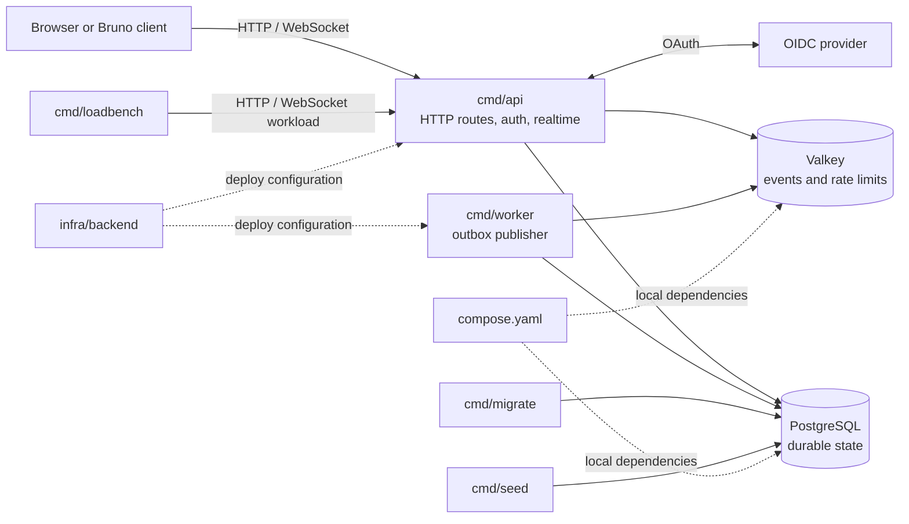

# Codebase map

This repository contains the Cloud Chat backend; the browser client is maintained separately.

## Runtime topology

The API commits each message and its outbox event together. The worker publishes committed events to Valkey, and API replicas deliver them to connected sockets. Clients recover missed events through the HTTP sync endpoint backed by PostgreSQL.

## Entry points

| Concern | Start here |
| --- | --- |
| API startup and process wiring | cmd/api/main.go |
| HTTP routes and message persistence | internal/httpapi/ |
| OIDC sessions and shared session rules | internal/auth/ |
| WebSocket subscriptions and delivery | internal/realtime/server.go |
| Outbox claims, leases, retries, and publishing | internal/outbox/worker.go |
| Shared Valkey rate limiting | internal/ratelimit/limiter.go |
| Shared message and event payloads | internal/message/ |
| Shared HTTP and WebSocket JSON validation | internal/strictjson/ |
| Request correlation IDs | internal/requestid/ |
| Isolated PostgreSQL test fixture | internal/testutil/ |
| Schema and migrations | internal/migrations/, internal/migrations/sql/ |
| Local services and container builds | compose.yaml, Dockerfile |
| AWS resources and operations | infra/backend/ |

## Source of truth

- [Local setup and commands](../README.md)
- [HTTP and WebSocket contract](api-contract.md)
- [Database schema](database-schema.md) and [initial DDL](database-schema.sql)
- [Architecture decisions](adr/README.md)
- [Backend implementation spec and tracker](../.scratch/chat-backend/spec.md) and [task map](../.scratch/chat-backend/map.md)
- [AWS module guide](../infra/backend/README.md)
- [Recorded local load and recovery evidence](adr/references/08-backend-load-and-recovery-evidence.md)

## Verification boundary

The repo contains local verification evidence and deploy configuration. A Terraform plan or local run does not establish that AWS resources, CI, Cognito, or CloudWatch were exercised; see the relevant tracker tickets for recorded status.
