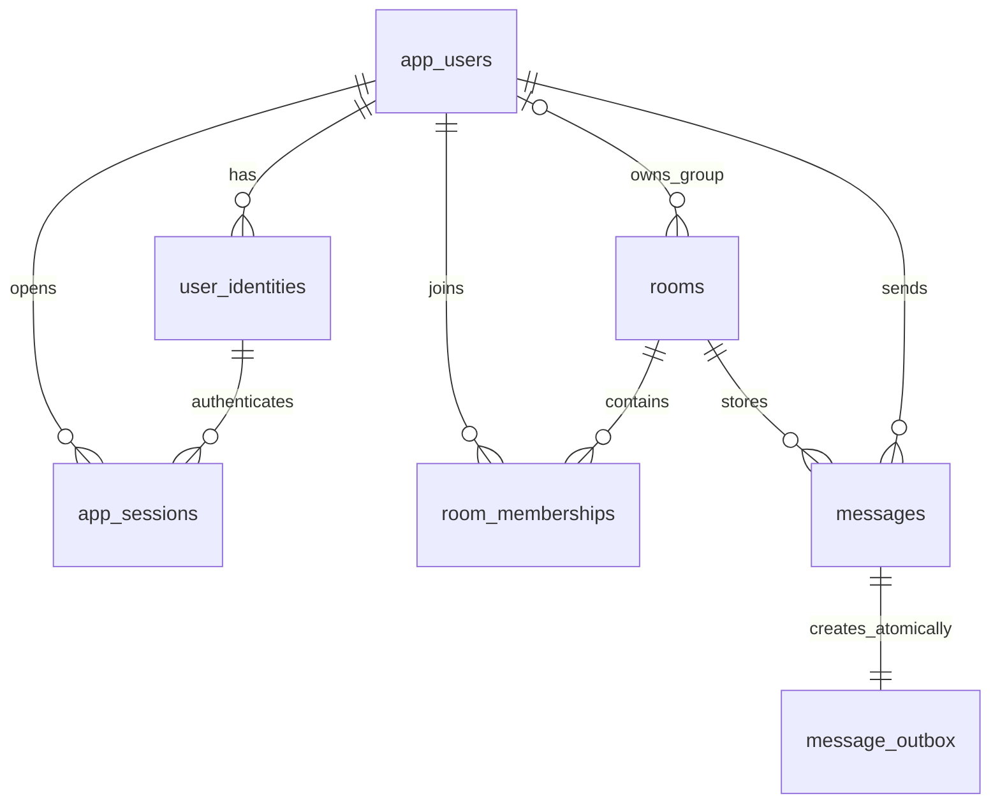

# โครงสร้างฐานข้อมูล PostgreSQL — เดโม Cloud Computing

**สถานะ:** แบบออกแบบ v1 จากสัญญา API และ ADR สำหรับนำไปทำ migration ยังไม่ได้ apply หรือทดสอบร่วมกับ PostgreSQL/RDS จริง ไม่ใช่หลักฐานว่าระบบพร้อมใช้งาน

อ้างอิง [สัญญา API](https://www.notion.so/40976688030081009f5dfa84e9f21b94), [ข้อสรุปการออกแบบ D01–D41](https://www.notion.so/40376688030081f98f64d898d7821ad4), [สถาปัตยกรรม](https://www.notion.so/403766880300819cb50bc46ac6cbf130) และ [แผนพัฒนา](https://www.notion.so/40376688030081c3aeabd73569cce7e4)

SQL ประกอบ: [database-schema.sql](database-schema.sql) เป็น DDL ฉบับออกแบบ ต้องใช้ร่วมกับกติกา transaction ในเอกสารนี้; constraints เพียงอย่างเดียวไม่ได้บังคับกฎธุรกิจทุกข้อ

## 1. ขอบเขตและชนิดข้อมูล

- PostgreSQL เป็นข้อมูลอ้างอิงถาวร; ใช้ schema เดียวของ modular monolith แยกฐานข้อมูล/credentials ระหว่าง environment
- UUID สร้างในแอปสำหรับรหัสหลัก; เวลาใช้ timestamptz และตอบ API เป็น UTC; ฐานข้อมูลใช้ UTF8
- seq ใช้ bigint ที่ฐานข้อมูล แต่ serialize เป็น decimal string ใน JSON; ตรวจช่วง 0 ถึง 9223372036854775807 ก่อน bind ไม่ใช้ float
- rooms.last_seq คือ seq สูงสุดที่ commit แล้ว ไม่ใช่ SEQUENCE/SERIAL; ขยับใน transaction เดียวกับ message และ outbox เท่านั้น
- ไม่ hard-delete ผู้ใช้ ห้อง หรือข้อความระหว่างโครงการ; FK ใช้ NO ACTION ไม่มี cascade ที่ทำให้ประวัติ/idempotency หายโดยไม่ตั้งใจ
- room_memberships เก็บสมาชิกปัจจุบัน ลบแถวเมื่อลบสมาชิก; การกลับเข้าห้องสร้างแถวใหม่และอ่านประวัติทั้งหมดตาม ADR ไม่ใช้ joined_at เป็นขอบเขตการอ่าน
- v1 ไม่มีตาราง read receipt, typing, presence, attachment, invitation UI, edit/delete หรือ recovery cursor ฝั่ง server; pending/cursor ต่ออุปกรณ์อยู่ IndexedDB

## 2. ความสัมพันธ์



oauth_login_attempts เป็นข้อมูลชั่วคราวก่อนรู้ตัวตน จึงยังไม่มี FK ไป users ความสัมพันธ์ message/outbox แบบหนึ่งต่อหนึ่งตอนสร้างเป็นกติกา transaction; DDL บังคับอย่างมากหนึ่ง outbox ต่อข้อความ แต่ไม่บังคับว่าทุกข้อความมี outbox ด้วย FK เพียงอย่างเดียว

## 3. ตารางตัวตนและเข้าสู่ระบบ

### app_users — ผู้ใช้ภายใน

| คอลัมน์ | ชนิด/เงื่อนไข | ความหมาย |
| --- | --- | --- |
| user_id | uuid PK | รหัสที่ API ส่งกลับ ไม่ใช่ Cognito subject |
| display_name | text NOT NULL, 1–100 ตัวอักษร | ตรวจไม่เป็น whitespace ล้วนในแอป |
| is_active | boolean, default true | ปิดสิทธิ์ใช้งานโดยเก็บประวัติไว้ |
| auth_epoch | bigint >= 0, default 0 | รุ่นการยืนยันตัวตนสำหรับ revoke ทุก session |
| created_at | timestamptz | เวลาสร้าง |

### user_identities — จับคู่ Cognito กับผู้ใช้

| คอลัมน์ | ชนิด/เงื่อนไข | ความหมาย |
| --- | --- | --- |
| identity_id | uuid PK | รหัสการเชื่อมตัวตน |
| user_id | uuid FK app_users | ผู้ใช้ภายใน |
| issuer, subject | text NOT NULL, UNIQUE คู่ | ใช้ (issuer, subject) ที่ตรวจ token แล้ว ห้ามใช้ email จับคู่เอง |
| created_at | timestamptz | เวลาผูก |

มี UNIQUE(identity_id,user_id) ให้ session อ้างอิงว่าตัวตนกับผู้ใช้ตรงกัน เตรียมคู่ตัวตนเดโมไว้ก่อน callback; ไม่รู้จักตัวตนให้ ACCOUNT_NOT_ALLOWED ไม่ auto-register จากข้อมูล browser

### app_sessions — session ร่วมทุก replica

| คอลัมน์ | ชนิด/เงื่อนไข | ความหมาย |
| --- | --- | --- |
| session_id | uuid PK | รหัสภายใน ห้ามใช้แทน cookie secret |
| token_hash | bytea 32 bytes UNIQUE | SHA-256 ของ session secret สุ่ม 256 bits; ไม่เก็บ cookie ดิบ |
| csrf_token_hash | bytea 32 bytes | SHA-256 ของ CSRF secret ที่ผูกกับ session |
| user_id, identity_id | uuid FK | composite FK ป้องกันการชี้ผู้ใช้กับตัวตนคนละคน |
| auth_epoch | bigint >= 0 | snapshot จาก app_users ตอนเปิด session |
| tokens_ciphertext, encryption_key_id | bytea, text | encrypted token bundle พร้อม nonce/tag ใน envelope และรหัส key; key อยู่นอกฐานข้อมูล |
| token_expires_at | timestamptz | อายุ token ที่ใช้กับ Cognito ไม่ใช่อายุ session |
| refresh_generation | bigint >= 0 | รุ่นป้องกันผล refresh เก่าทับของใหม่ |
| refresh_lease_token, refresh_lease_until | uuid nullable, timestamptz nullable | คู่ต้องมีหรือไม่มีพร้อมกัน |
| created_at, last_seen_at | timestamptz | เวลาสร้าง/กิจกรรมล่าสุด |
| expires_at, idle_expires_at | timestamptz | อายุสูงสุด 8 ชม., idle 30 นาทีตาม API; idle ไม่เกินอายุสูงสุด |
| revoked_at | timestamptz nullable | เพิกถอนเครื่องนี้ |

GET session ต้องคืน CSRF token เดิมได้: เก็บ CSRF secret แบบเข้ารหัสใน tokens_ciphertext envelope ฝั่ง server แล้วคืนเฉพาะ CSRF secret ให้ browser; access/refresh token ห้ามส่งออก ใช้ hash ตรวจ POST แบบ constant-time ไม่สร้าง CSRF ใหม่ทุก GET จนอีก tab ใช้ไม่ได้

ตรวจ session: hash ตรง, user active, epoch เท่ากัน, revoked_at เป็น null และ clock_timestamp() ยังไม่ถึง expires_at/idle_expires_at; touch idle เมื่อผ่านการตรวจเท่านั้น และห้ามต่ออายุ session ที่หมดไปแล้ว

### oauth_login_attempts — state/nonce/PKCE ใช้ครั้งเดียว

| คอลัมน์ | ชนิด/เงื่อนไข | ความหมาย |
| --- | --- | --- |
| state_hash | bytea 32 bytes PK | hash ของ OAuth state สุ่ม |
| browser_binding_hash | bytea 32 bytes | ผูก state กับ secret ใน Secure/HttpOnly cookie ชั่วคราวของ browser |
| nonce_hash | bytea 32 bytes | ตรวจ nonce ของ ID token หลังแลก code |
| pkce_verifier_ciphertext, encryption_key_id | bytea, text | verifier ต้องอ่านคืนได้ จึงเข้ารหัส ไม่ hash อย่างเดียว |
| created_at, expires_at | timestamptz | อายุ 5 นาที |
| consumed_at | timestamptz nullable | ใช้ได้ครั้งเดียว แม้หลาย replica |

callback จองด้วย UPDATE ... WHERE consumed_at IS NULL AND expires_at > clock_timestamp() AND browser_binding_hash ตรง แล้ว RETURNING และ commit ก่อนแลก code ภายนอก; ตรวจ issuer/audience/signature/nonce/PKCE ให้ครบ ถ้าล้มเหลวให้เริ่ม login ใหม่ ไม่เปิด state เดิมกลับมาใช้

## 4. ตารางห้องและสมาชิก

### rooms

| คอลัมน์ | ชนิด/เงื่อนไข | ความหมาย |
| --- | --- | --- |
| room_id | uuid PK | รหัสห้อง |
| kind | text CHECK dm/group | ชนิดห้อง |
| title | text 1–200 ตัวอักษร | ชื่อห้องเดโม; ห้าม whitespace ล้วนในแอป |
| owner_user_id | uuid FK nullable | group ต้องมี; dm ต้อง null |
| dm_user_low, dm_user_high | uuid FK nullable | dm ต้องมีคู่ที่ low < high; group ต้อง null ทั้งคู่ |
| last_seq | bigint >= 0, default 0 | ตัวนับแบบ transactional |
| created_at | timestamptz | เวลาสร้าง |

partial UNIQUE(dm_user_low,dm_user_high) WHERE kind='dm' ป้องกันคู่ DM ซ้ำแม้สลับลำดับผู้ใช้

### room_memberships

| คอลัมน์ | ชนิด/เงื่อนไข | ความหมาย |
| --- | --- | --- |
| room_id, user_id | uuid composite PK + FK | มีแถว = เป็นสมาชิกปัจจุบัน |
| member_role | text CHECK member/admin | owner ไม่เก็บซ้ำใน role; คำนวณจาก rooms.owner_user_id |
| joined_at | timestamptz | เวลาเข้าครั้งปัจจุบัน ไม่จำกัดประวัติที่อ่าน |

API membership_role = owner เมื่อ user_id ตรง owner_user_id ไม่เช่นนั้นใช้ member_role; DM คืน member เสมอ

FK (room_id,owner_user_id) → room_memberships(room_id,user_id) แบบ DEFERRABLE INITIALLY DEFERRED บังคับว่าเจ้าของกลุ่มยังเป็นสมาชิก ณ commit; สร้าง group และสมาชิกเจ้าของใน transaction เดียว และโอน owner ก่อนลบสมาชิกเจ้าของ

กฎข้ามตารางที่แอป/seed ต้องบังคับภายใต้ room lock และทดสอบ: DM มีสมาชิกสองคนตรงคู่เท่านั้นและ role=member, ห้ามเปลี่ยนคู่ DM, owner เท่านั้นแต่งตั้ง admin/โอนเจ้าของ, admin ลบ owner ไม่ได้, owner ออกก่อนโอนไม่ได้ CHECK ปกติไม่ตรวจหลายแถวแทนกฎเหล่านี้ และ DDL นี้ยังไม่มี trigger สำหรับกฎ DM สองคน

## 5. ตารางข้อความและ outbox

### messages

| คอลัมน์ | ชนิด/เงื่อนไข | ความหมาย |
| --- | --- | --- |
| message_id | uuid PK | รหัสข้อความถาวร |
| room_id | uuid FK rooms | ห้อง |
| seq | bigint > 0, UNIQUE(room_id,seq) | ลำดับต่อห้อง |
| sender_user_id | uuid FK app_users | ไม่ FK ไป membership เพื่อให้ลบสมาชิกแล้วประวัติยังอยู่ |
| sender_display_name | text 1–100 ตัวอักษร | snapshot ชื่อเพื่อ replay ได้ผลเดิม |
| client_message_id | uuid | UNIQUE(sender_user_id,room_id,client_message_id) |
| text | text, UTF-8 1–4096 bytes | DB ไม่รับ U+0000; แอปตรวจ Unicode/ไม่เป็น whitespace ล้วน โดยไม่ trim/normalize |
| created_at | timestamptz | server timestamp ไม่ใช้เรียงแทน seq |

ไม่มี updated_at/deleted_at เพราะข้อความ v1 immutable; จำกัด role runtime ไม่ให้ UPDATE/DELETE messages ไม่ใช้ ON CONFLICT DO UPDATE แก้เนื้อหาเมื่อรหัสซ้ำ

### message_outbox

| คอลัมน์ | ชนิด/เงื่อนไข | ความหมาย |
| --- | --- | --- |
| outbox_id | uuid PK | รหัสงาน |
| message_id | uuid UNIQUE FK messages | หนึ่งงาน message.created ต่อข้อความ |
| event_type, schema_version | text=message.created, smallint=1 | ระบุวิธี serialize ที่ worker รองรับ |
| available_at | timestamptz | รอบถัดไปที่ลองส่งได้ |
| attempt_count | integer >= 0 | จำนวนครั้งจองเพื่อ publish |
| lease_token, lease_until | uuid/timestamptz nullable | fencing token ต่อการจอง ไม่ใช้ worker ID เดิมแทน |
| published_at | timestamptz nullable | Pub/Sub รับ publish แล้ว ไม่ใช่ผู้รับอ่านแล้ว |
| last_error_code | text nullable | code ที่ตัดข้อมูลลับ ไม่เก็บ payload/stack/raw token |
| created_at | timestamptz | ใช้วัดอายุ backlog |

ไม่เก็บ payload JSON ซ้ำ Worker join messages แล้ว serialize Message v1 ซึ่ง immutable; ล้มหลัง publish ก่อน mark จะส่งซ้ำได้ตาม ADR เก็บแถว published ตลอดเดโมเพื่อเห็นผลและกันงานซ้ำ ไม่ cleanup messages/idempotency ระหว่างโครงการ

## 6. Indexes และเส้นทาง query

| API/งาน | Index หลัก | วิธีอ่าน |
| --- | --- | --- |
| session จาก cookie | UNIQUE app_sessions(token_hash) | hash secret แล้ว join user/identity |
| revoke sessions ของ user | app_sessions(user_id,session_id) | lock user ก่อน แล้ว session เรียงรหัส |
| Cognito callback | UNIQUE user_identities(issuer,subject) | จับคู่ตัวตนที่ตรวจแล้ว |
| GET rooms | room_memberships(user_id,room_id) | keyset room_id > cursor; join rooms; limit+1 |
| ตรวจสมาชิก | PK room_memberships(room_id,user_id) | ตรวจปัจจุบันรวม session ทุกครั้ง |
| ส่งซ้ำ | UNIQUE messages(sender_user_id,room_id,client_message_id) | เปรียบเทียบ text จริงก่อนตอบ replay/409 |
| history | UNIQUE messages(room_id,seq) | seq < before_seq, ORDER BY seq DESC, limit+1 |
| sync | UNIQUE messages(room_id,seq) | after_seq < seq <= through_seq, ORDER BY seq, limit+1 |
| claim outbox | partial (available_at,outbox_id) unpublished | available_at ถึงแล้วและ lease ว่าง/หมดอายุ; SKIP LOCKED |
| cleanup | expires_at/idle_expires_at และ published_at | ทำเป็น batch ไม่ lock ตารางยาว |

unique B-tree (room_id,seq) ใช้อ่านทั้งสองทิศ ไม่สร้าง index ซ้ำเพื่อ ASC/DESC; query ต้องตรวจสิทธิ์ก่อนอ่านแม้ index จะหาได้เร็ว ตรวจ EXPLAIN ANALYZE ด้วยข้อมูล/โหลดจริงภายหลัง

## 7. Transaction ส่งข้อความและแข่งกับลบสมาชิก

ใช้ READ COMMITTED และกติกาล็อกของแอป ไม่อ้างว่า isolation เพียงอย่างเดียวป้องกันทุก race

ลำดับร่วมสำหรับงานที่ต้องล็อกหลายชนิด: app_users เรียง user_id → app_sessions เรียง session_id → rooms เรียง room_id → room_memberships → messages → message_outbox; lock ผู้ใช้ทุกคนที่ต้องใช้ล่วงหน้า ห้ามถือ room แล้วกลับไปขอ user lock

ขั้นตอนส่ง:

1. เริ่ม transaction; lock ผู้ส่ง app_users FOR SHARE แล้ว session FOR UPDATE ตรวจ active/epoch/revocation/อายุอีกครั้งหลังรอ lock; touch idle แบบไม่เกิน expires_at
2. lock rooms FOR UPDATE แล้วตรวจสมาชิกด้วย statement ใหม่หลังได้ lock; ถ้าไม่มีตอบ 404 โดยไม่อ่าน replay ให้ผู้ถูกลบ
3. หา idempotency key เดิม ถ้า text ตรงคืนข้อความเดิมโดยไม่เพิ่ม seq/outbox; ถ้าต่างตอบ 409
4. ถ้าใหม่ UPDATE rooms SET last_seq=last_seq+1 ... RETURNING last_seq โดยตรวจไม่ให้ bigint ล้น
5. INSERT messages พร้อม snapshot ชื่อ และ INSERT message_outbox ใน transaction นี้
6. commit ก่อนตอบ HTTP; ถ้าผล commit ไม่แน่นอน client ใช้ client_message_id เดิม retry

ห้ามเพิ่ม last_seq แล้วใช้ INSERT ... ON CONFLICT DO NOTHING และ commit เพราะอาจทิ้งลำดับขาด หาก constraint ชนทั้งที่ตรวจแล้วให้ rollback ทั้ง transaction แล้วประเมินซ้ำด้วย transaction ใหม่ จัดการ deadlock/serialization failure ด้วย retry ที่จำกัดและใช้รหัสเดิม

คำสั่งเพิ่ม/ลบสมาชิก/โอนเจ้าของต้อง lock room เดียวกันก่อนตรวจสิทธิ์และเปลี่ยนแถว รวม admin script/seed ถ้าลบ commit ก่อนผู้ส่งได้ room lock ผู้ส่งต้องตรวจ membership ใหม่และถูกปฏิเสธ ถ้าส่งได้รับอนุญาตก่อน การลบจะรอและข้อความนั้นอาจถึงผู้รับตาม ADR

history/sync/subscribe/live ตรวจสมาชิกและ session จาก primary ด้วย READ COMMITTED statement ใหม่ ไม่ใช้สิทธิ์จาก snapshot transaction เก่าหรือ read replica ที่อาจตามไม่ทัน; ไม่ถือ transaction รอส่ง network การตรวจที่เริ่มก่อน removal commit อาจส่งผลที่อนุญาตแล้วได้

## 8. Outbox lease และ retry

ค่าเริ่มต้นที่เสนอ: batch 20, lease 30 วินาที, timeout publish 5 วินาทีต่อรายการ, retry แบบ full jitter เพดาน 60 วินาที; งาน batch ส่งแบบมี concurrency จำกัดและต่อ lease ของงานที่ยังรอ ห้ามเริ่ม publish หลัง lease หมด

```sql
-- พารามิเตอร์: $1=batch, $2=lease token UUID ใหม่ต่อ batch
WITH picked AS (
  SELECT outbox_id FROM message_outbox
  WHERE published_at IS NULL
    AND available_at <= clock_timestamp()
    AND (lease_until IS NULL OR lease_until <= clock_timestamp())
  ORDER BY available_at, outbox_id
  FOR UPDATE SKIP LOCKED
  LIMIT $1
)
UPDATE message_outbox o
SET lease_token = $2,
    lease_until = clock_timestamp() + interval '30 seconds',
    attempt_count = attempt_count + 1
FROM picked p WHERE o.outbox_id = p.outbox_id
RETURNING o.*;
```

commit การจองก่อน publish ภายนอก; เมื่อสำเร็จ mark published_at พร้อมล้าง lease โดย WHERE outbox_id ตรง, lease_token ตรง, published_at IS NULL และ lease_until ยังไม่หมด; UPDATE 0 แถวหมายถึงเสีย lease ห้ามเขียนทับเจ้าของใหม่

ล้มเหลวให้ available_at เป็นเวลาลองใหม่ พร้อมล้าง lease และเก็บ error code ภายใต้เงื่อนไข fencing เดียวกัน ถ้า worker ตาย lease หมดแล้วตัวอื่นรับต่อได้ ต่อ lease ด้วย token เดิมและเงื่อนไขยังไม่หมดอายุเท่านั้น

fencing ในฐานข้อมูลป้องกัน mark ทับกัน แต่ไม่กัน publish ซ้ำที่ network; client ต้อง dedup และ sync เสมอ ไม่มีการรับรอง exactly-once หรือการเรียง Pub/Sub ตาม seq

งาน retry เกิน 10 ครั้งแจ้งเตือนและยัง retry ต่อแบบจำกัดความถี่ ไม่ mark ว่าส่งสำเร็จ/ไม่ลบทิ้งเงียบ ๆ; event ที่ schema ไม่รองรับให้คงงาน pending เก็บ code และแก้ worker ไม่ลดหลักประกันข้อมูล

## 9. Session, logout-all และ refresh แข่งกัน

- เปิด session: lock user FOR SHARE ก่อน insert และ copy auth_epoch ปัจจุบัน; logout-all lock user FOR UPDATE เพิ่ม epoch และ revoke sessions เดิมใน transaction เดียว จึงไม่หลุด session ที่เปิดแข่งกันจาก epoch เก่า
- login ที่เริ่มสร้าง session หลัง logout-all commit เป็นการเข้าสู่ระบบครั้งใหม่ที่อนุญาตได้
- logout เครื่องเดียว: lock user ก่อน session แล้วตั้ง revoked_at; ห้าม refresh หรือต่อ idle ทำให้กลับ active
- refresh: transaction สั้นจอง refresh_lease_token/เวลาและ refresh_generation ภายใต้ user/session locks แล้ว commit; เรียก Cognito นอก transaction; บันทึกด้วย compare-and-set ที่ token/generation ตรง, lease ยังไม่หมด, user active, epoch ตรงและ session ยังไม่ revoke/หมดอายุ
- หาก refresh network outcome ไม่แน่นอนและ token rotation ทำให้ใช้ต่อไม่ได้ ให้ revoke session นั้นและ login ใหม่ แทนการเสี่ยงใช้ token เก่าหรือทำให้ session ที่ revoke แล้วกลับมา
- ใช้ clock_timestamp() หลังได้ lock เพื่อตรวจอายุจริง ไม่ใช้เวลาเริ่ม transaction ที่อาจค้างรอ lock นาน
- expired/revoked rows เก็บช่วงสั้นตาม runbook แล้ว cleanup เป็น batch; ล้าง token ciphertext ที่ไม่ใช้แล้ว โดยไม่ลบผู้ใช้หรือประวัติ

## 10. สิ่งที่อยู่นอก PostgreSQL และ API mapping

| สิ่ง | ตำแหน่ง | หมายเหตุ |
| --- | --- | --- |
| pending sends + contiguous cursor | IndexedDB แยก user/room/device | บันทึกข้อความที่รับกับ cursor ใน browser transaction เดียว |
| socket/subscription/คิวจำกัด | หน่วยความจำแต่ละ API replica | ไม่ต้องตาราง sockets; reconnect แล้ว sync |
| Pub/Sub notification + rate limit | Valkey แยก prefix/environment | เป็นข้อมูลชั่วคราว ไม่ใช่ประวัติข้อความ/session |
| database credentials/กุญแจเข้ารหัส | Secrets Manager และการตั้งค่าที่จำกัดสิทธิ์ | ไม่ใส่ raw key ในตาราง/source/image |
| trace/request ID | logs/telemetry | ไม่เพิ่มคอลัมน์เป็น idempotency key |

POST message → rooms + memberships + messages + outbox; GET rooms → memberships + rooms; history/sync → messages + authorization; session/logout → users + sessions; Cognito login → oauth_login_attempts + identities + sessions

sync อ่าน last_seq และหน้าแรกจาก statement snapshot เดียวหรือ transaction READ COMMITTED ที่อ่าน last_seq ก่อนและใช้ขอบบนเดิม; สมาชิกตรวจใหม่ในทุกหน้า ข้อมูลหลัง through_seq ไม่รวม snapshot; ห้ามเลื่อน cursor ข้ามช่องว่าง rooms.last_seq ไม่ใช่ read receipt

## 11. Migration, สิทธิ์ และหลักฐานคลาวด์ของสองคน

- คน A: สร้าง migration/seed, RDS private networking ร่วมกับ B, connection pool, ECS API/worker credentials, constraints/transaction/outbox และผลทดสอบ recovery/failover
- คน B: เชื่อม Secrets Manager/task roles/CI migration job ตามส่วนที่รับผิดชอบ, รัน migration แบบควบคุมครั้งเดียว, แสดง dashboard/rolling deploy/rollback และทดสอบ login/cookie ผ่าน CloudFront/ALB
- ทั้งสองตรวจ pool รวมของ API+worker+migration ไม่เกินงบ connections ของ RDS; ทดสอบ primary reconnect และส่งรหัสเดิมหลัง failover ตามเวลา/เครดิต ไม่อ้างว่า replicas 1/1 แปลว่าแอปพร้อม
- บัญชี migrator มี DDL; API มีสิทธิ์เท่าที่ใช้และไม่มี UPDATE/DELETE messages; worker อ่านข้อความและเปลี่ยนเฉพาะ outbox; cleanup ใช้ role แยก ไม่ให้ runtime เป็น superuser/เจ้าของ schema
- initial migration: users → identities → sessions/oauth → rooms → memberships → deferred owner FK → messages → outbox → indexes; group seed ต้องสร้าง room+owner membership ใน transaction เดียว
- เปลี่ยน schema ต่อไปใช้ expand → migrate usage → contract รองรับ image เก่า/ใหม่ซ้อนกัน; ไม่ให้ทุก API replica auto-migrate ตอนเริ่ม
- schema นี้เป็นการออกแบบระดับ SQL ไม่สร้าง RDS/AWS resources และไม่เปลี่ยนงบ/region/engine ที่ยังต้องยืนยัน

## 12. เกณฑ์ตรวจรับและข้อจำกัดการยืนยัน

- [ ] apply DDL บน PostgreSQL เวอร์ชันที่เลือกจริง สร้าง/ล้าง local ได้ และ seed group/DM ผ่าน
- [ ] constraint ปฏิเสธ idempotency ซ้ำ, seq ซ้ำ, DM คู่กลับด้านซ้ำ และ owner ที่ไม่เป็นสมาชิก
- [ ] ตรวจแยกกฎที่ DDL บังคับกับกฎในแอป: DM สองคน, role/owner, whitespace, immutability และ message+outbox ครบคู่
- [ ] 100 concurrent retries ได้ข้อความ/outbox เดียว; text ต่างได้ 409; rollback ไม่เพิ่ม last_seq และข้อความถัดไปยังต่อเนื่อง
- [ ] ลบสมาชิกแข่งกับ send/read/subscribe/live/replay แล้วตรง ADR รวม notification การลบหาย
- [ ] worker หลายตัว, lease หมด, ตายหลัง publish และผล mark จาก worker เก่าไม่ทำงานหาย
- [ ] logout-all แข่งกับ login/refresh/POST แล้ว session เก่าไม่กลับมามีสิทธิ์; idle หมดระหว่างรอ lock ไม่ถูกต่ออายุ
- [ ] sync หลายหน้า/ประวัติ/ลำดับใหญ่กว่า JavaScript safe integer ได้ผลถูกต้อง และ cursor ไม่ข้ามข้อมูล
- [ ] ตรวจ EXPLAIN ANALYZE, lock waits/deadlocks, RDS connections, oldest outbox age และการกู้หลังเปลี่ยน replica
- [ ] migration/rollback ของแอปและ cleanup ไม่ลบประวัติ/token/idempotency ผิดนโยบาย พร้อมหลักฐานที่ตัดข้อมูลลับ

การตรวจครั้งนี้: เทียบ schema กับ API/ADR และตรวจเอกสารเชิงโครงสร้าง ยังไม่ได้รัน SQL/ทดสอบ concurrency/integration เพราะ Docker engine ในเครื่องไม่พร้อม จึงคงรายการตรวจรับทั้งหมดเป็นยังไม่ผ่าน

## แหล่งอ้างอิง PostgreSQL

- [Row locking และ deadlock](https://www.postgresql.org/docs/current/explicit-locking.html) — ใช้ประกอบลำดับ lock; ต้องใช้ร่วมกับกติกาแอป
- [Constraints และ foreign keys](https://www.postgresql.org/docs/current/ddl-constraints.html) — CHECK ไม่ใช่ตัวตรวจความสัมพันธ์หลายแถวแทน transaction
- [Transaction isolation](https://www.postgresql.org/docs/current/transaction-iso.html) — READ COMMITTED และผลของ sequence ที่ไม่ rollback เป็นเหตุผลให้ใช้ transactional counter
