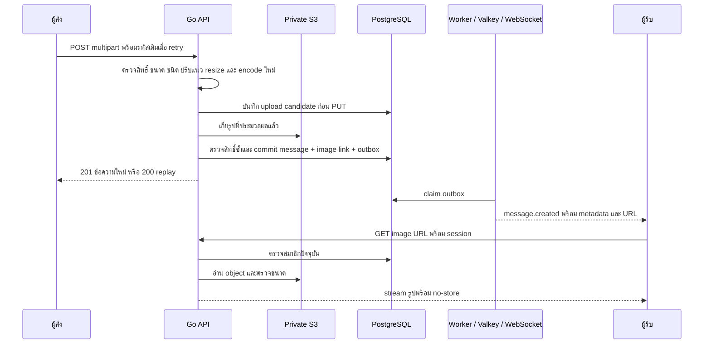

# ส่งรูปในข้อความสนทนา

Backend รองรับรูปหนึ่งไฟล์ในทั้ง DM และกลุ่ม คำบรรยายไม่บังคับ ใช้ API/worker เดิมและ private S3; local ใช้ SeaweedFS ร่วมกัน Frontend composer, pending หลัง refresh และ viewer เป็นงานแยก

## สัญญาและข้อจำกัด

| ส่วน | พฤติกรรม |
| --- | --- |
| ส่ง | `POST /api/v1/rooms/{room_id}/messages`; `multipart/form-data` มี `client_message_id`, `image` หนึ่งไฟล์ และ optional `text` |
| ข้อความล้วน | endpoint เดิมรับ JSON ตามเดิม; text ต้องไม่ว่าง |
| ต้นทาง | JPEG/PNG/WebP ไม่เกิน 5 MiB, request รวม 6 MiB, 25 ล้านพิกเซล, แต่ละด้านไม่เกิน 16,384 px; ไม่รับ animation |
| รูปที่เก็บ | ปรับ orientation, ตัด metadata, ด้านยาวไม่เกิน 2,560 px ไม่ขยายภาพเล็ก และคง alpha; output JPEG/PNG ไม่เกิน 5 MiB |
| Caption | ว่างได้เมื่อมีรูป; UTF-8 ไม่เกิน 4,096 bytes ไม่รับ U+0000 |
| เวลา/ความพร้อม | หนึ่ง image pipeline ต่อ API task; เต็มตอบ 429 `IMAGE_UPLOAD_BUSY`, `Retry-After: 1`; body read deadline 45 วินาที หมดเวลาตอบ 408 `UPLOAD_TIMEOUT` |
| Retry | รหัสเดิมพร้อม caption/ไฟล์ต้นทางเดิมคืน message เดิม; เปลี่ยนเนื้อหาหรือสลับ image/text ตอบ 409 `IDEMPOTENCY_CONFLICT` |
| อ่าน | `GET /api/v1/rooms/{room_id}/messages/{message_id}/image`; ตรวจ session/สมาชิกก่อนอ่าน ไม่มี public/presigned URL; stream พร้อม `no-store`, `nosniff` และขอบเขตเวลา 10 วินาที |
| อ่านขาดกลางทาง | retry เฉพาะ GET รูป ไม่ส่งข้อความใหม่ |
| Cleanup | worker ล้าง candidate ที่ไม่ได้ส่งเกิน 24 ชั่วโมง ลองลบซ้ำหลัง tombstone 24 ชั่วโมง; ไม่ลบรูปที่ผูกกับข้อความแล้ว |

HTTP response, history, sync และ live event ใช้ optional `image` เดียวกัน: `url`, `content_type`, `byte_size`, `width`, `height` โดยไม่ส่ง binary ผ่าน WebSocket ผู้รับที่ออฟไลน์กู้ข้อความและ URL ด้วย sync

## Local และ Bruno

เริ่ม `postgres`, `valkey`, `media`; รัน migration, seed, API และ worker ตาม [README](../README.md) Go ไม่โหลด `.env` เอง ให้ตั้ง environment ใน shell ตามคู่มือ Local เปิด image sending โดยค่าเริ่มต้น

เปิด [Bruno collection](../bruno/cloud-chat-local/README.md) เลือก environment `local` รัน HTTP 01–07 และ image flow 09–17 ตามลำดับ มี PNG 8×8 พร้อม alpha รวมอยู่แล้ว คง image ID, caption และไฟล์เดิมสำหรับ retry; เปลี่ยน ID หากต้องการข้อความใหม่ ดู live event โดยเปิด WebSocket 08 แยกก่อนส่ง

## Rollout AWS

1. deploy API/worker รุ่นที่รองรับ schema 1 และ 2 ให้ครบก่อน migration รุ่นเก่าที่รองรับเฉพาะ schema 1 ไม่ใช่ rollback target หลัง migration
2. รัน migration 0002 แบบควบคุม ตรวจ readiness, text send/replay/history/sync และ outbox จากนั้นตรวจ shared edge configuration
3. ตรวจ upload, protected read และ live delivery ผ่าน origin จริง

รายละเอียดอยู่ใน [release guide](../infra/README.md) และ [shared CloudFront configuration/checker](../infra/shared-edge/README.md) API/worker อยู่ private subnet, S3 เป็น private bucket และ IAM จำกัด media prefix การ deploy อาจตัด upload เมื่อครบ drain budget; client ใช้รหัสเดิม retry

## หลักฐานและขอบเขต

Backend ผ่าน Go suite, race tests และ integration ด้วย PostgreSQL/Valkey/SeaweedFS ใน local รวม schema 1 → 2, image retry/outbox, alpha, ถอนสมาชิก, stalled upload และ stream/truncation ตาม [ticket 03](../.scratch/image-messages/issues/03-harden-image-runtime.md) Terraform validation/offline plan ผ่านด้วย dummy credentials ยังไม่มีการ deploy หรือทดสอบ AWS จริง และไม่ได้อ้าง capacity หรือทดสอบ codec edge cases ทุกแบบ

เอกสารอ้างอิง: [API contract](api-contract.md), [schema](database-schema.md), [ADR 0007](adr/0007-image-send-and-private-storage.md), [feature spec](../.scratch/image-messages/spec.md)
